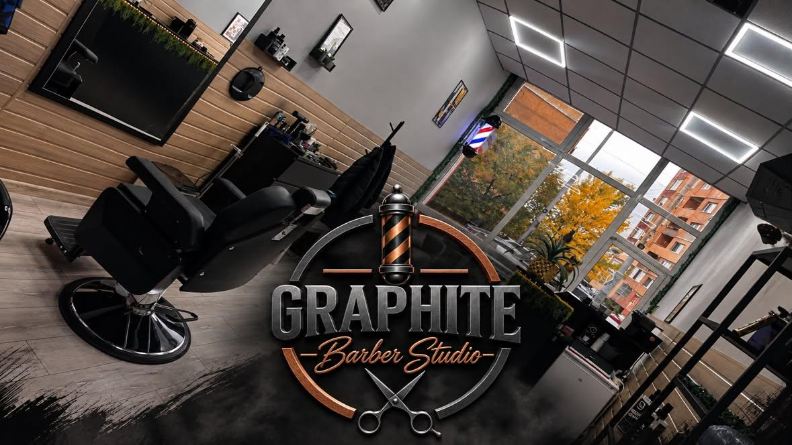
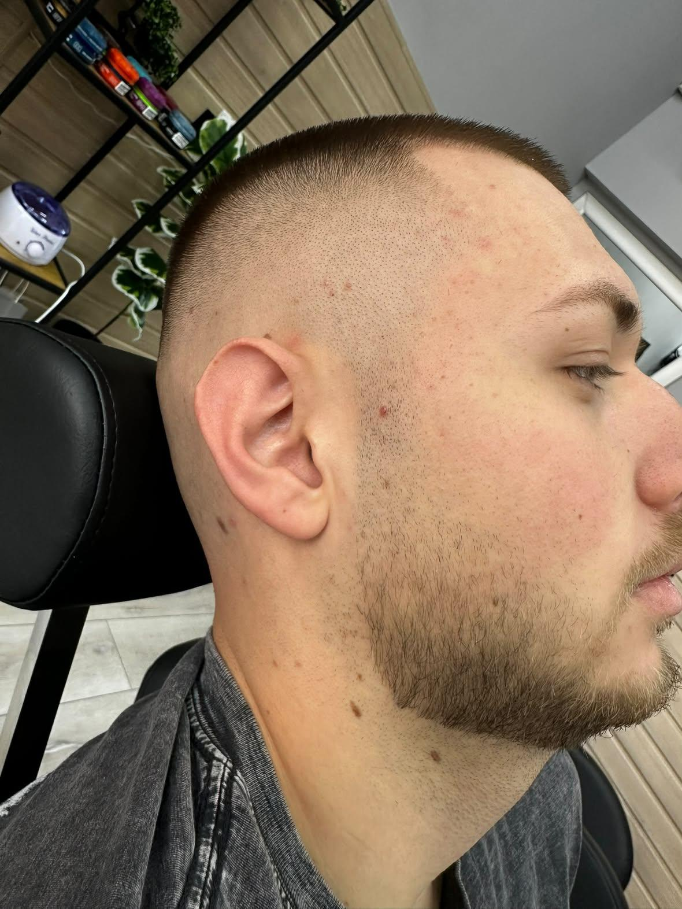
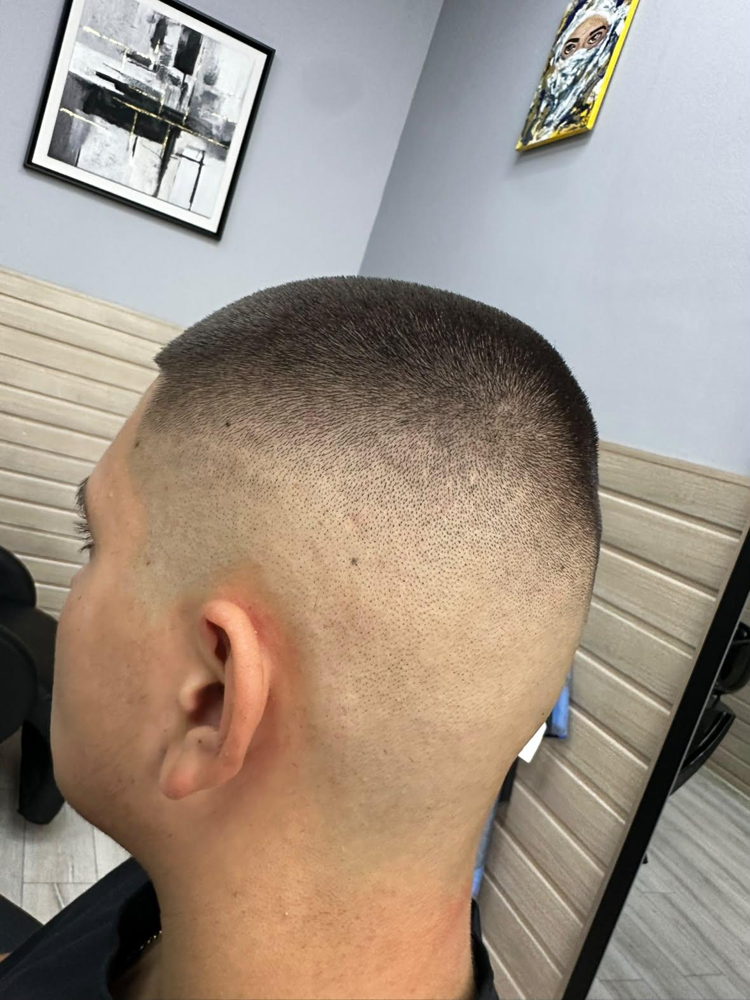
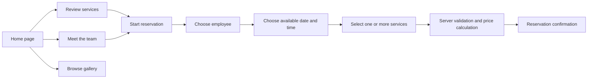
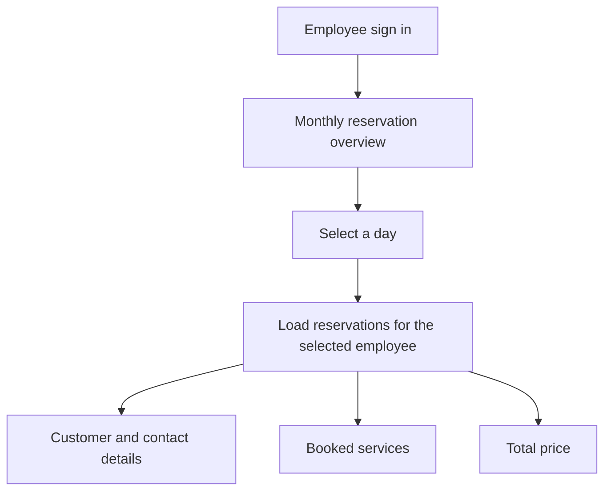
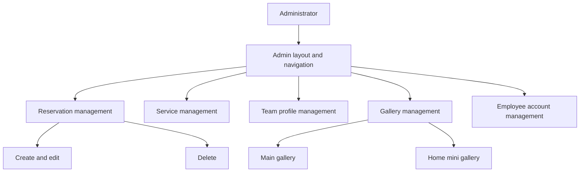
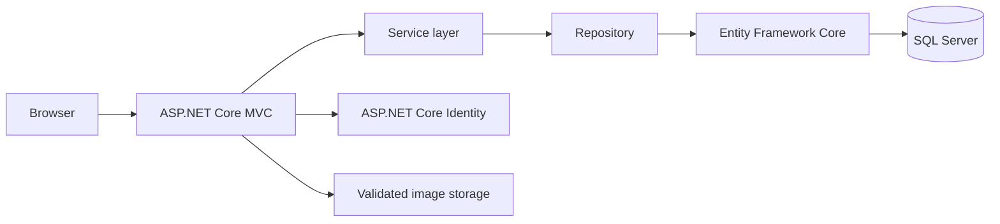
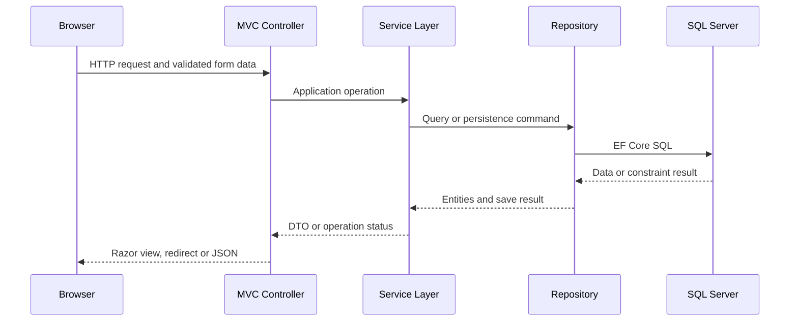

# Graphite Barber Studio

Full-stack ASP.NET Core MVC application for a barber studio. Customers can browse services and staff, view available time slots and create reservations. Administrators manage bookings, services, staff accounts and both public galleries from a role-protected interface.

<p align="center">
  
</p>

<p align="center">
  <strong>ASP.NET Core MVC booking and studio management platform</strong>
</p>

<p align="center">
  
  
  
  
  
</p>



## Contents

- [Product tour](#product-tour)
- [Customer experience](#customer-experience)
- [Employee workspace](#employee-workspace)
- [Administrator workspace](#administrator-workspace)
- [Reservation integrity](#reservation-integrity)
- [Architecture](#architecture)
- [Local setup](#local-setup)
- [Security measures](#security-measures)
- [Deployment notes](#deployment-notes)

## Highlights

- Customer reservation flow with employee, date, time and multi-service selection.
- Server-side price calculation based on the current service prices in SQL Server.
- Live busy-slot lookup for the selected employee.
- Database-level protection against double booking through a unique index on employee, date and time.
- Administrative workflows for reservations, services, team profiles and gallery content.
- Employee reservation view protected by ASP.NET Core Identity authentication.
- Secure image uploads with extension checks, file-signature validation and generated file names.
- Responsive Razor views with dedicated layouts for customers, employees and administrators.
- One-time scroll reveal animations with a visible-by-default fallback for browsers without JavaScript animation support.

## Product tour

The application presents the studio as a complete customer-facing website while keeping day-to-day management behind authenticated role-based views.

### Studio gallery

<table>
  <tr>
    <td width="33%" align="center"></td>
    <td width="33%" align="center"></td>
    <td width="33%" align="center"></td>
  </tr>
  <tr>
    <td align="center"><strong>Fade and beard</strong></td>
    <td align="center"><strong>Classic styling</strong></td>
    <td align="center"><strong>Detailed finish</strong></td>
  </tr>
</table>

### Team presentation

<table>
  <tr>
    <td width="33%" align="center"></td>
    <td width="33%" align="center"></td>
    <td width="33%" align="center"></td>
  </tr>
  <tr>
    <td align="center">Profile, description and certificate</td>
    <td align="center">Responsive employee card</td>
    <td align="center">Book directly with a selected professional</td>
  </tr>
</table>

## Customer experience

Visitors do not need an account. The public interface is designed around a short booking path:



### Public pages

| Area | What the visitor can do |
| --- | --- |
| Home | Discover the studio, brand, featured gallery and booking call to action |
| Services | Compare available services, descriptions and prices |
| Team | View employee profiles, additional information and certificates |
| Gallery | Browse studio work in a responsive two-column layout |
| Reservation | Select an employee, load busy slots, choose services and submit a booking |
| Confirmation | Review the saved booking and server-calculated total price |

The browser only submits identifiers and customer input. Availability, employee existence, selected services and the final price are verified again on the server.

## Employee workspace

Authenticated employees use a focused schedule view. It displays reservation counts by day and loads the selected day's customer, contact, service and price details on demand.



Employee accounts can only be created by an administrator. Deleted accounts lose their authenticated session on the next request because security stamps are checked without a delay.

## Administrator workspace

The administrator view is a separate management experience protected by the `Admin` role. It provides the operational controls needed to maintain the studio without editing source code.

| Module | Administrator actions | Protection and validation |
| --- | --- | --- |
| Reservations | View schedules, create, edit and delete bookings | Server validation and database-level slot uniqueness |
| Services | Create, edit and remove services and prices | Model validation and role authorization |
| Team | Add, edit and delete employee profiles | Image format validation and generated file names |
| Gallery | Upload and remove main and home-gallery images | Extension and binary file-signature checks |
| Accounts | Create employee logins and remove employee accounts | Admin-only pages; administrator password required before deletion |



## Application roles

| Role | Capabilities |
| --- | --- |
| Visitor | Browse the studio, services, team and gallery; create a reservation without an account |
| Employee | Sign in and view employee reservation schedules |
| Administrator | Manage reservations, services, staff profiles, employee accounts and gallery images |

Employee account registration is restricted to administrators. The initial administrator is created when the application first starts and the configured account does not already exist.

## Technology

- .NET 10 and ASP.NET Core MVC
- Razor Views and Razor Pages
- Entity Framework Core 10
- SQL Server
- ASP.NET Core Identity and role-based authorization
- JavaScript, HTML5, CSS3 and Bootstrap
- Dependency injection, repository abstraction and asynchronous database operations

## Architecture



### Request path



| Project | Responsibility |
| --- | --- |
| `HairSalon-Website` | Controllers, Razor views, Identity pages and static assets |
| `HairSalon.Services.Core` | Reservation, service, staff and gallery business logic |
| `HairSalon.Data` | DbContext, repository, entity configuration, DTOs and migrations |
| `HairSalon.Data.Models` | Domain model project |
| `HairSalon.DataTransferObjects` | Shared data-transfer project |
| `HairSalon.Common` | Shared validation constants |

## Reservation integrity

The application validates selected services, employee identifiers, dates and time slots in the service layer. It calculates the total price from database values instead of trusting values submitted by the browser.

The `Reservations` table also has a unique index over:

```text
HairDresserId + ReservationDate + ReservationTime
```

This index is the final protection against two concurrent requests booking the same employee and slot.

## Local setup

### Requirements

- .NET 10 SDK
- SQL Server 2022, SQL Server Express or another compatible SQL Server instance
- Visual Studio 2026 or a terminal with the .NET CLI

Clone the repository and move into the solution directory:

```powershell
git clone https://github.com/simo1409-04/HairSalon-Website.git
cd HairSalon-Website\HairSalon-Website
```

Restore the solution:

```powershell
dotnet restore HairSalon-Website.slnx
```

### Configuration

The application reads the database connection from `ConnectionStrings:DefaultConnectionString`. The recommended local setup is to override it through an environment variable:

```powershell
$env:ConnectionStrings__DefaultConnectionString = 'Server=.\SQLEXPRESS;Database=HairSalonDb;Trusted_Connection=True;TrustServerCertificate=True'
```

For SQL Server Authentication, use the credentials created for that SQL Server instance:

```powershell
$env:ConnectionStrings__DefaultConnectionString = 'Server=YOUR_SERVER;Database=HairSalonDb;User Id=YOUR_USER;Password=YOUR_PASSWORD;Encrypt=True;TrustServerCertificate=True'
```

Set the initial administrator password before the first application start:

```powershell
$env:InitialAdmin__Password = 'Choose-A-Strong-Local-Password1!'
```

Do not commit production connection strings or passwords.

### Apply all migrations

From the solution directory, run:

```powershell
dotnet tool restore
dotnet ef database update --project HairSalon.Data/HairSalon.Data.csproj --startup-project HairSalon-Website/HairSalon_Website.csproj
```

`dotnet ef database update` applies every pending migration in chronological order. A manually generated migration script is only needed when deployment policy requires a reviewed SQL artifact.

To generate an idempotent script that can safely check the migration history before applying pending changes:

```powershell
dotnet ef migrations script --idempotent --project HairSalon.Data/HairSalon.Data.csproj --startup-project HairSalon-Website/HairSalon_Website.csproj --output migration.sql
```

### Run the application

```powershell
dotnet run --project HairSalon-Website/HairSalon_Website.csproj --launch-profile https
```

Local addresses:

- `https://localhost:7004`
- `http://localhost:5002`

The migrations create the schema and seed demonstration staff, services and reservations. The application startup creates the `Admin` role and initial administrator when they do not already exist. Database migrations remain an explicit setup step.

## Security measures

- Automatic antiforgery-token validation for MVC requests.
- ASP.NET Core Identity password rules and role-based authorization.
- Security-stamp validation on every authenticated request so deleted employee sessions expire immediately.
- HTTPS redirection and HSTS outside Development.
- Server-side validation for reservation identifiers, dates, slots and prices.
- Unique database index for concurrent double-booking protection.
- Image extension and binary-signature checks for gallery uploads.
- Generated file names and path validation for uploaded gallery content.

## Deployment notes

Production hosting requires:

1. A SQL Server connection string in `ConnectionStrings__DefaultConnectionString`.
2. An initial administrator password in `InitialAdmin__Password` for the first startup.
3. The EF Core migrations applied to the target database.
4. Write access to the application image directories because gallery and staff images are stored on disk.
5. HTTPS configured with a certificate trusted for the public domain.

For deployments that replace the application directory, uploaded image folders should be included in the hosting backup strategy or moved to durable object storage.

## Repository

[github.com/simo1409-04/HairSalon-Website](https://github.com/simo1409-04/HairSalon-Website)

## License

See [LICENSE](LICENSE).
